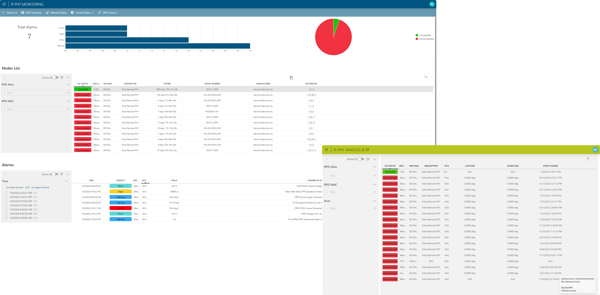
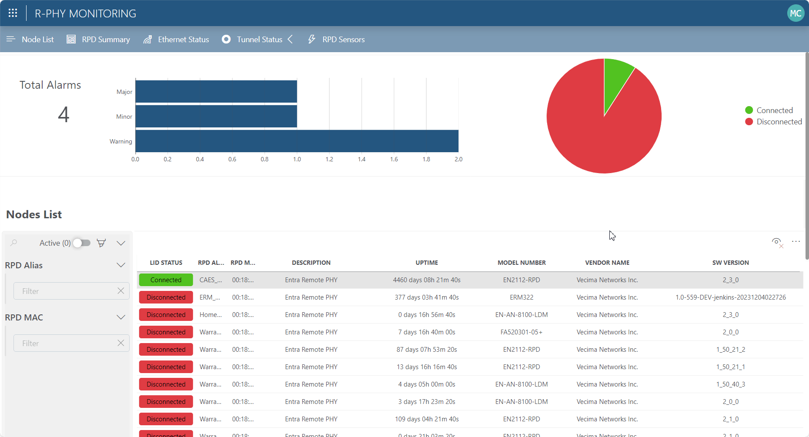

# Remote PHY Monitoring

## About

The **Remote PHY Monitoring** package empowers you to effortlessly access and consolidate data from one or more remote PHY devices. It contains two low-code apps and a **Vecima RPM** driver.

Currently, Vecima RPM is the only device supported by this solution.

## Key Features

The single entry point provided for the operator's entire installed base of remote PHY nodes eliminates the need for operators to hop between the interfaces of the different RPM elements.

